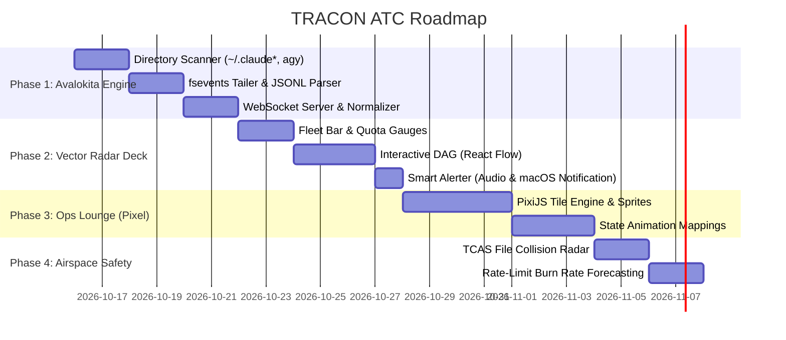

# 📡 TRACON ATC: Master Implementation Plan & Engineering Spec

## 1. Project Identity & Philosophy

- **Product Name**: **TRACON ATC** (Short: **Tracon**)
- **Sub-Brand / Core Daemon**: **Avalokita Engine** (*The Thousand-Eyed Observer*)
- **Core Value Proposition**: Universal air traffic control for local AI coding agent fleets across multiple Claude accounts (`claude-a`, `claude-b`, `claude-c`), Antigravity (`agy`), and parallel terminal sessions.

---

## 2. System Architecture & Components

```
+----------------------------------------------------------------------------------------------------+
|                                      TRACON ATC ARCHITECTURE                                       |
+----------------------------------------------------------------------------------------------------+
                                                  │
          ┌───────────────────────────────────────┴────────────────────────────────────────┐
          ▼                                                                                ▼
+───────────────────────────────────+                            +───────────────────────────────────+
|     AVALOKITA ENGINE (DAEMON)     |                            |      TRACON FLIGHT DECK (UI)      |
+───────────────────────────────────+                            +───────────────────────────────────+
| 1. Airspace Scanner:              |                            | 1. Dual-View Mode Switcher:       |
|    - Watches ~/.claude*           |                            |    - Vector Radar (War Room DAG)  |
|    - Watches ~/.gemini/antigravity|                            |    - Ops Lounge (Pixel Office)    |
|    - Detects active PIDs / TTYs   |                            | 2. Fleet Radar Header:            |
| 2. File Tailer (fsevents):        |       WebSocket (:4040)    |    - Active flight badges         |
|    - Streams JSONL transcripts    | ─────────────────────────> |    - Quota & Burn rate gauges     |
| 3. Normalizer & Collision Engine: |                            | 3. Smart ATC Alerter:             |
|    - Maps to FlightEvents         |                            |    - Holding pattern notifications|
|    - Cross-agent file lock check  |                            |    - Audio transponder chime      |
+───────────────────────────────────+                            +───────────────────────────────────+
```

---

## 3. Data Ingestion: The Avalokita Telemetry Engine

### 3.1 Multi-Account Claude Ingestion
- **Target Directories**:
  - `~/.claude/projects/`
  - `~/.claude-*/projects/` (e.g., `~/.claude-a`, `~/.claude-b`, `~/.claude-c`)
  - Any path provided via `CLAUDE_CONFIG_DIR`
- **File Types**: `*.jsonl` transcript files.
- **Key Fields Parsed**:
  - Session ID, project root directory, model name.
  - User messages, assistant thinking turns, tool invocations (`ToolUse`), tool results (`ToolResult`).
  - Waiting-for-user state (`input_request`, permission confirmations).

### 3.2 Antigravity (`agy`) Ingestion
- **Target Directory**: `~/.gemini/antigravity-cli/brain/<conversation-id>/`
- **Files Parsed**:
  - `transcript.jsonl` (compact event stream) & `transcript_full.jsonl` (full payloads).
  - Background task status in `.system_generated/tasks/task-*.log`.
  - Subagent declarations and invocations (`invoke_subagent`, `define_subagent`).
- **Telemetry Mapping**:
  - Main Agent -> Primary Flight.
  - Subagent (`research`, `firestore-rules-author`, etc.) -> Escort / Sub-flight.
  - Background task -> Automated sortie.

### 3.3 Normalized Event Schema (`FlightPacket`)

```typescript
export interface FlightPacket {
  id: string;                      // Unique event UUID
  timestamp: string;               // ISO 8601
  flightCallsign: string;          // e.g. "CL-A", "CL-B", "AGY-01"
  accountTier: "pro_20" | "team_100" | "api_usage" | "gemini";
  runtime: "claude-code" | "antigravity" | "opencode";
  pid?: number;                    // Terminal process ID
  cwd: string;                     // Working repository path
  flightState: 
    | "preflight"                  // Initializing / prompt entered
    | "cruising"                   // Actively thinking / streaming
    | "tool_executing"             // File read/write, bash running
    | "holding"                    // WAITING FOR HUMAN INPUT / APPROVAL
    | "landed"                     // Task completed
    | "aborted";                   // Exited / failed
  activeTool?: {
    name: string;
    action: "read" | "write" | "bash" | "subagent" | "other";
    targetFile?: string;
    details?: string;
  };
  subagents: {
    id: string;
    role: string;
    state: string;
  }[];
  fuelMetrics: {
    inputTokens: number;
    outputTokens: number;
    totalTokens: number;
    burnRatePerMin: number;
    quotaPercentage?: number;
  };
  collisionWarning?: {
    conflictingFlight: string;
    sharedFile: string;
  };
}
```

---

## 4. Dual-View UI Specification

### View A: The Vector Radar ("War Room")
- **Tech Stack**: `@xyflow/react` (React Flow) + TailwindCSS + Lucide Icons.
- **Visuals**: Dark tactical theme, radar sweeps, flight vectors.
- **Core Modules**:
  1. **Airspace Overview**: Visual cards of all active flights with transponder squawks (`SQ-20`, `SQ-100`, `SQ-AGY`).
  2. **Live Execution DAG**: Interactive nodes representing turns, tools, and subagents with branch latency and token cost badges.
  3. **File Attention Heatmap**: Tree visualizer of the repository showing read/write intensity across all agents.
  4. **Collision Monitor (TCAS)**: Highlights in amber/red when two independent sessions touch the same file within a 5-minute window.

### View B: The Ops Lounge ("Pixel Office")
- **Tech Stack**: PixiJS hardware-accelerated 2D canvas.
- **Visuals**: 16-bit retro flight operations room.
- **Core Modules**:
  1. **Radar Consoles**: Each active flight sits at a designated retro workstation with their account badge above them.
  2. **Character State Machine**:
     - *Cruising/Thinking*: Pacing, looking at flight maps.
     - *Writing/Editing*: Typing furiously with neon particle effects.
     - *Running Shell*: Console screen glowing.
     - *Holding (Wait State)*: Pulsing exclamation speech bubble over character's head + alarm bell.
  3. **Subagent Drones**: Mini orbital characters hovering around the main desk when `invoke_subagent` is triggered.

---

## 5. Implementation Milestones



---

## 6. Directory Scaffolding Plan

```
TRACON/
├── README.md                      # Official Tracon Documentation
├── findings.md                    # Research benchmark & synthesis
├── package.json                   # Root workspace manifest
├── packages/
│   ├── avalokita-engine/          # Core Telemetry Ingestion Daemon
│   │   ├── src/
│   │   │   ├── scanners/          # Multi-Claude & Agy path discoverers
│   │   │   ├── tailers/           # fsevents file-watchers
│   │   │   ├── parsers/           # Claude & Antigravity JSONL parsers
│   │   │   ├── normalizer.ts      # Unified FlightPacket creator
│   │   │   ├── collision.ts       # File conflict detector (TCAS)
│   │   │   └── server.ts          # WebSocket server (:4040)
│   │   └── package.json
│   ├── tracon-ui/                 # Frontend Web Deck
│   │   ├── src/
│   │   │   ├── components/
│   │   │   │   ├── radar/         # Vector Radar & DAG views
│   │   │   │   ├── lounge/        # PixiJS Pixel Office
│   │   │   │   ├── fleet/         # Flight cards & Quota meters
│   │   │   │   └── alerts/        # Holding pattern notifications
│   │   │   ├── App.tsx
│   │   │   └── main.tsx
│   │   └── package.json
│   └── tracon-cli/                # Global CLI runner (`tracon start`)
│       ├── bin/tracon.js
│       └── package.json
```

---

## 7. Decisions (MVP build, 2026-10-16)

Choices the plan left open, and where findings.md or the real data on this machine overrode it.

**Status (2026-10-16):** built and verified: Phase 1 (p1_1 to p1_3) and Phase 2 (p2_1 Fleet Bar & Quota Gauges, p2_2 Interactive DAG, p2_3 Smart Alerter). p4_1 TCAS is built too (`collision.ts`, 2026-10-16): writes only, a subagent's writes fold into its parent, warnings clear 5 minutes after the last shared write. Not built: Phase 3 (p3_1, p3_2 Ops Lounge), p4_2 burn-rate forecasting, and the File Attention Heatmap from section 4 (no milestone in section 5).

| Topic | Decision | Why |
|---|---|---|
| Engine runtime | Node.js TypeScript run directly by Node's type stripping (Node >= 23.6), no build step | findings.md allows Node or Go; this needs no compiler output and keeps `.ts` files as in section 6 |
| File watching | `fs.watch(recursive)` (FSEvents on macOS) plus a 2 s poll | No chokidar dependency. The poll finds new profiles and moves time-based states (holding, leaving the window) |
| Claude transcript path | `<profile>/projects/<project>/<sessionId>.jsonl`; subagents in `<sessionId>/subagents/agent-*.jsonl` (+ `.meta.json` for the role) | findings.md's `transcript*.jsonl` glob does not match Claude Code's real file names |
| agy transcript path | `brain/<conv>/.system_generated/logs/transcript.jsonl`, falling back to the documented `brain/<conv>/transcript.jsonl` | That is where the installed `agy` writes it. `transcript_full.jsonl` is not read (the compact one has every field used) |
| PID / live state | Claude Code's `<profile>/sessions/<pid>.json` (fields `pid`, `sessionId`, `status` only; `*.key` files are never opened). Dead pid = `aborted`, `idle` = `landed`, `busy` after the turn = `cruising` | The only live process signal on disk; no `ps` scraping |
| Holding detection | `AskUserQuestion`/`ExitPlanMode` pending, a live status containing wait/input/permission, an agy `WAIT*` status, or any tool call with no result and no new transcript line for 60 s | Transcripts have no "awaiting approval" entry. A long build also shows as holding after 60 s |
| Fuel | input = `input_tokens + cache_creation_input_tokens`; cache reads excluded; one API response counted once (keyed by message id); burn = tokens in the last 5 min / 5 | Cache reads re-count the whole context every turn and would swamp the gauge |
| `accountTier` | `TRACON_TIERS="BIZ=team_100,WORK=api_usage"` (profile suffix, `""` = `~/.claude`); unlisted Claude profiles are `pro_20`, agy is `gemini` | Plan tiers are not recorded anywhere on disk |
| `quotaPercentage` | From `TRACON_QUOTA` usage mirrors (5-hour window); unset otherwise, and the gauge shows `n/a` | Transcripts carry no quota; only a status line sees `rate_limits` |
| Callsign | `CL-<PROFILE>-<first 4 of session id>` (`CL-BIZ-CF5A`), `CL-<id4>` for `~/.claude`, `AGY-<id4>` | Unique per session, still short |
| Airspace | Sessions with a transcript line in the last 30 min (`TRACON_WINDOW_MIN`) or a live pid | Hundreds of old transcripts exist |
| Wire format | Every WebSocket message (and `GET /api/flights`) is `{"flights": FlightPacket[]}`, the whole airspace, sent on change. A packet keeps its `id` until its content changes | Clients learn when a flight leaves; reconnects need no replay |
| Server | One process on `127.0.0.1:4040`: `/ws`, `/api/flights`, and the built UI. Socket refuses non-localhost `Origin` | Any web page could otherwise read session paths and commands |
| Orchestration | `src/airspace.ts` (scan + tail + normalize, no network) sits between the modules of section 6 and `server.ts` | Testable end to end without sockets |
| Lint | `tsc --noEmit` on both packages (strict) is the lint step; no ESLint | No extra toolchain for a two-package repo |
| DAG data (p2_2) | Not in `FlightPacket`. Each `Flight` keeps a `TraceNode` list (types.ts): turn, tool and subagent nodes with start/end and tokens, served on demand at `GET /api/trace?flight=<callsign>`. Last 40 turns, up to 100 tool calls per turn; `Agent`/`Task` calls are never trimmed | Broadcasting every flight's history on each change would grow the socket traffic; the deck asks only for the flight it shows |
| DAG shape | A turn starts at a user prompt (or at agent work after a finished turn). Tools in one message fan out from the same parent; the next message hangs off the last of them. Turn tokens use the same per-response de-duplication as fuel | Mirrors how Claude Code and agy actually batch tool calls |
| Subagent edges | A Claude subagent attaches to the latest `Agent`/`Task` call before its first line, within that turn; else to the turn | Transcripts give no direct link; on this machine 377 of 379 subagents matched a spawning call |
| Durations | A node's end is clamped to its start | Some transcripts append lines stamped earlier than the line before |
| DAG layout | One column per turn, children stacked below; no layout library (no dagre/elk). Opens zoomed on the six most recent nodes | Turn sequence is linear, so a column layout is enough |
| Alerter (p2_3) | In the Flight Deck: WebAudio two-tone chime plus the browser `Notification` API (macOS Notification Center). Opt-in via the ALERTS toggle (stored in `localStorage`), once per flight per 2 min, tab title shows the holding count | Audio and notifications both need a user gesture or permission in the browser; the engine stays a read-only observer with no `osascript` |

## 8. Partner App (built 2026-10-17)

A cross-platform partner app that lists held decisions and answers them from anywhere, so a long session at home keeps going while you are out. Chosen with the owner: build it in TRACON (one inbox for every profile) rather than per-session Remote Control, reach the Mac over Tailscale, and make the client the Flight Deck as an installable PWA.

**Spike (Claude Code 2.1.302, interactive sessions in a scratch project with project-level HTTP hooks):**

| Check | Result |
|---|---|
| AskUserQuestion answered by PreToolUse `allow` + `updatedInput.answers` | Works; multi-select as `"Cheese, Olives"`, shown as "User answered Claude's questions" |
| ExitPlanMode via PreToolUse | `allow` + `updatedInput` approves ("User approved Claude's plan"); `deny` + reason rejects, Claude revises and re-presents |
| PermissionRequest `allow` / `deny` | Works ("Allowed by PermissionRequest hook"); input has no `tool_use_id` |
| PermissionRequest for AskUserQuestion | Does not fire (only PreToolUse) |
| Does the terminal wait for the hook? | PreToolUse: yes, no dialog until the hook replies. PermissionRequest: **no**, the dialog shows at once and whichever answers first wins |
| Terminal answers first | Claude does **not** close the hook request; it stays open until the hook replies |
| Session killed | The hook request closes |
| Empty 200 reply, or engine down | The normal terminal dialog appears |
| `timeout: 3600` | Accepted |
| `claude -p` | No AskUserQuestion tool, so headless sessions have nothing to answer |

| Topic | Decision | Why |
|---|---|---|
| Mechanism | Two HTTP hooks per profile (`tracon hooks install`): PreToolUse `AskUserQuestion\|ExitPlanMode` and PermissionRequest `*`, both to `127.0.0.1:4040/hook/*`, timeout 3600 s | No script to install; engine down = connection error = normal prompt |
| Away mode | Questions and plans are held only while away (`auto` = 3 min HID idle via `ioreg`, or pinned on/off). Becoming present releases them with an empty reply, so the terminal asks | They block the terminal while held; you must never be stuck at the desk |
| Permission holds | Always held (they race the terminal dialog). Released when the transcript shows the matching call (name + input) waiting and then no longer waiting; swept right after holding and on every poll | Claude does not cancel the hook when you answer at the terminal; the transcript is the only signal |
| Hold limit | Engine replies empty at 3500 s | Ahead of the 3600 s hook timeout, so the terminal always gets the prompt back |
| Two listeners | `:4040` local (UI, API, hooks; POSTs with a foreign Origin refused). `:4041` remote (UI, API, socket behind the device token, never `/hook/*`), published by `tailscale serve` | A tailnet device must never be able to forge a hook reply; CSRF from websites on the Mac |
| Token | 32 random bytes in `~/.config/tracon/token`, compared in constant time; `tracon pair --rotate` replaces it | One user, many devices; rotate = sign out everywhere |
| Engine writes | `state.ts` only, only `~/.config/tracon/{token,vapid.json,subscriptions.json}`; `check.sh`'s read-only guard exempts just that file | Still never writes `~/.claude*` or `~/.gemini`; settings changes live in the CLI (`hooks.js`) with backups |
| Push | `web-push` (VAPID + aes128gcm); new holds pushed only while away; 404/410 subscriptions dropped | Payload encrypted end to end through Apple/Google push |
| Client | Flight Deck + manifest + push-only service worker (no offline cache); pairing via `#pair=<token>` saved to localStorage | One codebase for iOS, Android, web, Linux, Windows, macOS |
| Wire format | Snapshot is now `{flights, decisions, away}`; a flight with a held decision is `holding` for certain | Answered-elsewhere and released decisions vanish from every device on the next message |
| Not built | Answering agy prompts (view only), "always allow" rules, sending a new prompt to an idle session, store-packaged apps | agy approval format unverified; no hook can inject a prompt |
