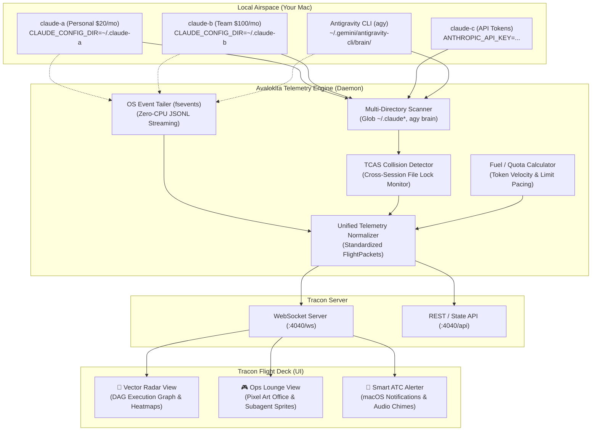

# 📡 TRACON ATC

<div align="center">

```
  ████████╗██████╗  █████╗  ██████╗ ██████╗ ███╗   ██╗     █████╗ ████████╗ ██████╗
  ╚══██╔══╝██╔══██╗██╔══██╗██╔════╝██╔═══██╗████╗  ██║    ██╔══██╗╚══██╔══╝██╔════╝
     ██║   ██████╔╝███████║██║     ██║   ██║██╔██╗ ██║    ███████║   ██║   ██║     
     ██║   ██╔══██╗██╔══██║██║     ██║   ██║██║╚██╗██║    ██╔══██║   ██║   ██║     
     ██║   ██║  ██║██║  ██║╚██████╗╚██████╔╝██║ ╚████║    ██║  ██║   ██║   ╚██████╗
     ╚═╝   ╚═╝  ╚═╝╚═╝  ╚═╝ ╚═════╝ ╚═════╝ ╚═╝  ╚═══╝    ╚═╝  ╚═╝   ╚═╝    ╚═════╝
```

### **Terminal Radar Approach Control for Autonomous AI Agent Fleets**
*Powered by the **Avalokita Telemetry Engine** — The Thousand-Eyed Observer.*

[](LICENSE)
[]()
[]()

</div>

---

## 🧭 Overview

**TRACON ATC** (short name: **Tracon**) is an ambient developer mission control system that transforms the chaotic, invisible execution of local AI coding agents into an intuitive, real-time radar control room.

Modern developers no longer run a single AI chat session. They operate **swarms**:
- Multiple Claude Code profiles (`claude-a` on a personal $20 Pro plan, `claude-b` on a $100 Team account, `claude-c` on pay-as-you-go API keys).
- Autonomous Google Antigravity (`agy`) swarms orchestrating parallel background subagents, sandbox tasks, and security reviewers.
- Multiple terminal tabs executing tool calls, file writes, and code inspections simultaneously.

Without radar, you are flying blind in unmonitored airspace. Agents sit idle for hours trapped in unseen confirmation prompts (`[y/n]`), file write collisions go unnoticed until git merge conflicts erupt, and token budgets burn invisibly.

**Tracon sweeps your laptop's airspace in real time, bringing tactical clarity and philosophical calm to agent orchestration.**

---

## 👁️ The Avalokita Telemetry Engine

At the core of Tracon sits the **Avalokita Engine**, named after *Avalokiteśvara* (Sanskrit: अवलोकित, *"The Thousand-Eyed Observer"* who watches across all realms simultaneously with unwavering attention).

```
                      ┌──────────────────────────────────────┐
                      │       AVALOKITA TELEMETRY ENGINE     │
                      │     "The Thousand-Eyed Observer"     │
                      └──────────────────┬───────────────────┘
                                         │
        ┌────────────────────────────────┼────────────────────────────────┐
        ▼                                ▼                                ▼
  [ Eye 001..099 ]                 [ Eye 100..199 ]                 [ Eye 200..999 ]
 Claude Multi-Profile             Antigravity (`agy`)               System Process
   Directory Watcher                Brain Transcripts                 Radar & Locks
 (~/.claude*, custom dirs)        (~/.gemini/antigravity-cli)       (PIDs, FSEvents)
```

The Avalokita Engine is a zero-latency, zero-overhead background daemon that:
1. **Never Blinks**: Continuously monitors all active agent log streams (`*.jsonl`), file modifications, and process IDs without requiring changes to your CLI tools or wrapping binaries.
2. **Normalizes Swarm Trajectories**: Converts heterogeneous events from Claude Code, Codex, and Antigravity into a unified, high-frequency telemetry stream.
3. **Broadcasts Real-Time Telemetry**: Emits normalized flight packets over local WebSocket channels (`ws://localhost:4040`) with sub-millisecond dispatch.

---

## 🛫 Aviation Metaphor & Core Concepts

Tracon maps the chaos of multi-agent development directly to airport radar operations:

| Aviation Concept | Agent Equivalent in Tracon |
| :--- | :--- |
| **Aircraft (Flight)** | An active agent CLI session (e.g. `Flight CL-A`, `Flight CL-B`, `Flight AGY-01`). |
| **Transponder / Squawk Code** | The identity tag distinguishing accounts (e.g. `Squawk 20` for Pro vs `Squawk 100` for Max). |
| **Drones / Escort Craft** | Subagents spawned by a parent agent (e.g. an `agy` `research` subagent). |
| **Holding Pattern** ⚠️ | An agent blocked waiting for human input, approval, or bash confirmation (`y/n`). |
| **Fuel Gauge / Burn Rate** | Token usage velocity and pacing toward hourly/daily rate-limit exhaustion. |
| **Bingo Fuel Warning** 🚨 | Quota alert when an account approaches rate-limit ceiling. |
| **TCAS / Collision Alert** ⚡ | Warning triggered when two independent agents attempt to modify the same file or worktree. |
| **Touchdown / Landed** ✅ | Task successfully completed, tests passing, or Pull Request opened. |

---

## 🎛️ Dual-Interface Experience

Tracon features a dual-mode presentation layer suited for both deep technical analysis and ambient side-monitor awareness:

### Mode 1: The Vector Radar ("War Room")
*Inspired by high-tech air traffic control displays and Agent Flow.*
- **Live Flight Screen**: Real-time vector radar showing active agent nodes, subagent branches, and data flows.
- **Execution DAG**: Interactive pan/zoom tree tracing exact sequences of prompts, tool calls, and outputs.
- **Branch Cost Trees**: Click into any flight path to see exact duration, token cost, and tool payload diffs.
- **File Attention Heatmap**: 2D tree map of your workspace showing which files are being swept or modified by which agent.

### Mode 2: The Ops Lounge ("Pixel Office")
*Inspired by Pixel Agents and retro simulation games.*
- **Ambient Pixel Art**: A 16-bit retro flight operations room designed to sit on a side display.
- **Desk per Account**: `claude-a`, `claude-b`, and `agy` have dedicated radar consoles and distinctive character sprites.
- **Dynamic Action Sprites**: Characters type frantically during code generation, study charts during file search, and pace nervously during long tests.
- **Speech Bubbles & Audio Chimes**: Instant visual and acoustic cues the moment an aircraft enters a *Holding Pattern* (waiting for your input).

---

## 🏗️ Technical Architecture



---

## ⚡ Quick Start (Planned CLI)

```bash
# Install Tracon globally
npm install -g tracon-atc
# or via homebrew
brew install tracon-atc

# Launch the Avalokita Engine and open the Flight Deck
tracon start

# Check active flights in terminal (TUI snapshot)
tracon status
```

### Example Terminal Status Output (`tracon status`)

```
========================= TRACON ATC RADAR ACTIVE =========================
AIRSPACE: /Users/blackbird/Everything/dev/labs/TRACON
ACTIVE FLIGHTS: 3 | HOLDING: 1 | BINGO FUEL WARNINGS: 0
---------------------------------------------------------------------------
SQUAWK   CALLSIGN   RUNTIME    STATE       CURRENT TOOL        BURN (TOKENS)
---------------------------------------------------------------------------
SQ-20    CL-A       claude-a   ACTIVE      replace_file_content 42.1k (48%)
SQ-100   CL-B       claude-b   HOLDING ⚠️  waiting_user_input   18.4k (18%)
SQ-AGY   AGY-01     agy        ACTIVE      invoke_subagent(res) 89.2k (31%)
---------------------------------------------------------------------------
HOLDING ALERT: Flight CL-B is waiting for bash command approval in tty3.
===========================================================================
```

---

## 🗺️ Project Roadmap

- [x] **Phase 0: Research & Synthesis** — Benchmark against existing visualizers (`agent-flow`, `pixel-agents`, `aiwatch`, `Session-Character-Visualizer`, `mcpmarket`).
- [ ] **Phase 1: Avalokita Engine MVP**
  - [ ] Multi-account directory scanner (`~/.claude*`, custom config paths).
  - [ ] Antigravity brain transcript reader (`~/.gemini/antigravity-cli/brain/`).
  - [ ] Unified WebSocket telemetry server (`ws://localhost:4040`).
- [ ] **Phase 2: The Tactical Radar Deck (Web UI)**
  - [ ] Live session cards with account badges and quota burn meters.
  - [ ] Interactive execution DAG using `@xyflow/react`.
  - [ ] Instant Holding Pattern alerts (sound chime + macOS notification).
- [ ] **Phase 3: The Ops Lounge (Pixel Office)**
  - [ ] PixiJS-powered 16-bit retro radar room.
  - [ ] Real-time character animations matching active tools (reading, writing, shell).
  - [ ] Subagents orbiting parent flight consoles.
- [ ] **Phase 4: Advanced Airspace Safety**
  - [ ] TCAS file conflict detector (preventing parallel agent git collisions).
  - [ ] Rate-limit trajectory predictions for $20 Pro vs $100 Team accounts.

---

## 🙏 Inspirations & Acknowledgments

A respectful nod of appreciation to the pioneering tools and creators who explored early agent visualization:
- **[Agent Flow](https://github.com/patoles/agent-flow)** by `@patoles`
- **[Pixel Agents](https://github.com/pixel-agents-hq/pixel-agents)** by `@pablodelucca`
- **[aiwatch / Subagent Viewer](https://github.com/nyanko3141592/subagent-viewer)** by `@nyanko3141592`
- **[Session Character Visualizer](https://github.com/Caffa/Session-Character-Visualizer)** by `@Caffa`
- **[Visualizing Subagents](https://mcpmarket.com/tools/skills/visualizing-subagents)** by `@WarrenZhu050413`

> [!NOTE]
> **Independent Implementation Note**: None of the code from the above projects was copied or used in TRACON. TRACON and the Avalokita Engine were architected and implemented from the ground up after personally using these tools and finding that none of them met the needs of modern multi-account, multi-runtime workflows (juggling multiple concurrent Claude profiles like `claude-a`, `claude-b`, and `claude-c` alongside Google Antigravity swarms). Their innovative ideas served as an inspiring spark for what was missing in the ecosystem.

---

## 📜 Philosophy

> *"To watch without interfering is the beginning of wisdom. To guide without controlling is the art of flight control."*

TRACON ATC merges the precision and safety-critical discipline of aerospace engineering with the ancient, unblinking mindfulness of Avalokiteśvara. It exists so developers can orchestrate massive fleets of autonomous agents with absolute confidence, joy, and peace of mind.

---

## 📄 License

MIT © 2026 TRACON ATC Contributors.
