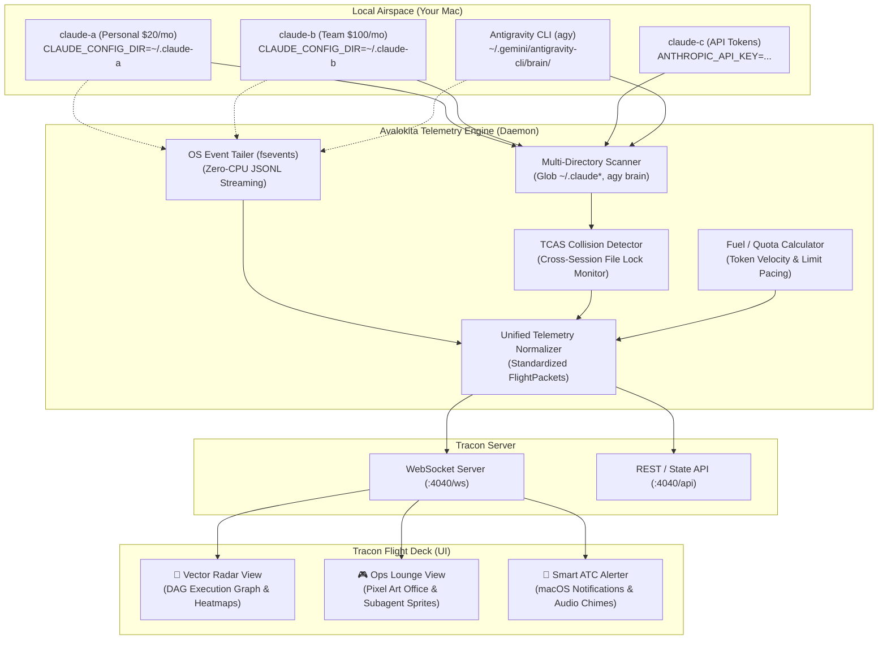

# 📡 TRACON ATC

<div align="center">

```
  ████████╗██████╗  █████╗  ██████╗ ██████╗ ███╗   ██╗     █████╗ ████████╗ ██████╗
  ╚══██╔══╝██╔══██╗██╔══██╗██╔════╝██╔═══██╗████╗  ██║    ██╔══██╗╚══██╔══╝██╔════╝
     ██║   ██████╔╝███████║██║     ██║   ██║██╔██╗ ██║    ███████║   ██║   ██║     
     ██║   ██╔══██╗██╔══██║██║     ██║   ██║██║╚██╗██║    ██╔══██║   ██║   ██║     
     ██║   ██║  ██║██║  ██║╚██████╗╚██████╔╝██║ ╚████║    ██║  ██║   ██║   ╚██████╗
     ╚═╝   ╚═╝  ╚═╝╚═╝  ╚═╝ ╚═════╝ ╚═════╝ ╚═╝  ╚═══╝    ╚═╝  ╚═╝   ╚═╝    ╚═════╝
```

### **Terminal Radar Approach Control for Autonomous AI Agent Fleets**
*Powered by the **Avalokita Telemetry Engine** — The Thousand-Eyed Observer.*

[](LICENSE)
[-yellow.svg)](judge.md)
[]()

</div>

---

## ⬇️ Download (macOS, no Node or git needed)

**[Download the latest beta (beta_0.1)](https://github.com/the-abraar/TRACON/releases/tag/beta_0.1)**: pick `tracon-macos-arm64.zip` for Apple Silicon (M1 and newer) or `tracon-macos-x64.zip` for Intel Macs. It is one self-contained file with the Flight Deck inside.

With [Homebrew](https://brew.sh) (no Gatekeeper warning, picks the right chip for you):

```bash
brew install the-abraar/tap/tracon && tracon
```

Without Homebrew, in Terminal (downloads, unzips and runs it):

```bash
curl -L "https://github.com/the-abraar/TRACON/releases/download/beta_0.1/tracon-macos-$(uname -m | sed s/x86_64/x64/).zip" -o tracon.zip && unzip -o tracon.zip && ./tracon
```

Downloaded in a browser instead? The build is not notarized by Apple, so macOS will say it can't verify it. Run `xattr -d com.apple.quarantine tracon` once in the unzipped folder, then `./tracon`.

`./tracon` opens the live radar right in your terminal (↑/↓ pick a flight, Enter shows its trace, `w` opens the browser Flight Deck, `q` quits). `./tracon start` runs the browser Flight Deck instead; `./tracon status` prints a one-shot snapshot. Beta: macOS only, Windows is untested.

---

## 🧭 Overview

**TRACON ATC** (short name: **Tracon**) is an ambient developer mission control system that transforms the chaotic, invisible execution of local AI coding agents into an intuitive, real-time radar control room.

Modern developers no longer run a single AI chat session. They operate **swarms**:
- Multiple Claude Code profiles (`claude-a` on a personal $20 Pro plan, `claude-b` on a $100 Team account, `claude-c` on pay-as-you-go API keys).
- Autonomous Google Antigravity (`agy`) swarms orchestrating parallel background subagents, sandbox tasks, and security reviewers.
- Multiple terminal tabs executing tool calls, file writes, and code inspections simultaneously.

Without radar, you are flying blind in unmonitored airspace. Agents sit idle for hours trapped in unseen confirmation prompts (`[y/n]`), file write collisions go unnoticed until git merge conflicts erupt, and token budgets burn invisibly.

**Tracon sweeps your laptop's airspace in real time, bringing tactical clarity and philosophical calm to agent orchestration.**

---

## 👁️ The Avalokita Telemetry Engine

At the core of Tracon sits the **Avalokita Engine**, named after *Avalokiteśvara* (Sanskrit: अवलोकित, *"The Thousand-Eyed Observer"* who watches across all realms simultaneously with unwavering attention).

```
                      ┌──────────────────────────────────────┐
                      │       AVALOKITA TELEMETRY ENGINE     │
                      │     "The Thousand-Eyed Observer"     │
                      └──────────────────┬───────────────────┘
                                         │
        ┌────────────────────────────────┼────────────────────────────────┐
        ▼                                ▼                                ▼
  [ Eye 001..099 ]                 [ Eye 100..199 ]                 [ Eye 200..999 ]
 Claude Multi-Profile             Antigravity (`agy`)               System Process
   Directory Watcher                Brain Transcripts                 Radar & Locks
 (~/.claude*, custom dirs)        (~/.gemini/antigravity-cli)       (PIDs, FSEvents)
```

The Avalokita Engine is a small read-only background process that:
1. **Watches**: Tails every Claude Code profile's session transcripts (`~/.claude*/projects/**/*.jsonl`), Claude Code's live-session pid files, and Antigravity brain transcripts, through FSEvents plus a 2-second poll. It never writes to those directories and needs no changes to your CLI tools.
2. **Normalizes**: Converts Claude Code and Antigravity events into one `FlightPacket` per session (schema in PLAN.md section 3.3).
3. **Broadcasts**: Pushes the whole airspace as `{"flights": FlightPacket[], "decisions": Decision[], "away": {...}}` over `ws://127.0.0.1:4040/ws` whenever it changes, and serves the same snapshot at `GET /api/flights`.
4. **Traces**: Keeps a bounded execution DAG per flight (the last 40 turns, up to 100 tool calls each) and serves it on demand at `GET /api/trace?flight=<callsign>` as `{"nodes": TraceNode[]}` (schema in `packages/avalokita-engine/src/types.ts`).
5. **Holds decisions** (opt-in, `tracon hooks install`): Claude Code's HTTP hooks send each question, plan approval and permission prompt to the engine, which holds it until a paired device answers or the terminal takes it back. See [Partner App](#-partner-app-answer-from-anywhere).

---

## 🛫 Aviation Metaphor & Core Concepts

Tracon maps the chaos of multi-agent development directly to airport radar operations:

| Aviation Concept | Agent Equivalent in Tracon |
| :--- | :--- |
| **Aircraft (Flight)** | An active agent CLI session (e.g. `Flight CL-A`, `Flight CL-B`, `Flight AGY-01`). |
| **Transponder / Squawk Code** | The identity tag distinguishing accounts (e.g. `Squawk 20` for Pro vs `Squawk 100` for Max). |
| **Drones / Escort Craft** | Subagents spawned by a parent agent (e.g. an `agy` `research` subagent). |
| **Holding Pattern** ⚠️ | An agent blocked waiting for human input, approval, or bash confirmation (`y/n`). |
| **Fuel Gauge / Burn Rate** | Token usage velocity and pacing toward hourly/daily rate-limit exhaustion. |
| **Bingo Fuel Warning** 🚨 | Quota alert when an account approaches rate-limit ceiling. |
| **TCAS / Collision Alert** ⚡ | Warning triggered when two independent agents attempt to modify the same file or worktree. |
| **Touchdown / Landed** ✅ | Task successfully completed, tests passing, or Pull Request opened. |

---

## 🎛️ Dual-Interface Experience (planned)

Built today: the fleet radar (one live card per session), the per-flight Execution DAG with latency and token badges, Holding Pattern alerts (chime plus system notification), TCAS file-collision warnings, and a quota gauge fed by a status-line usage mirror (`TRACON_QUOTA`). The File Attention Heatmap, Branch Cost diffs, the Ops Lounge and Bingo Fuel forecasting below are not built yet (see [judge.md](judge.md)).

Tracon features a dual-mode presentation layer suited for both deep technical analysis and ambient side-monitor awareness:

### Mode 1: The Vector Radar ("War Room")
*Inspired by high-tech air traffic control displays and Agent Flow.*
- **Live Flight Screen**: Real-time vector radar showing active agent nodes, subagent branches, and data flows.
- **Execution DAG**: Interactive pan/zoom tree tracing exact sequences of prompts, tool calls, and outputs.
- **Branch Cost Trees**: Click into any flight path to see exact duration, token cost, and tool payload diffs.
- **File Attention Heatmap**: 2D tree map of your workspace showing which files are being swept or modified by which agent.

### Mode 2: The Ops Lounge ("Pixel Office")
*Inspired by Pixel Agents and retro simulation games.*
- **Ambient Pixel Art**: A 16-bit retro flight operations room designed to sit on a side display.
- **Desk per Account**: `claude-a`, `claude-b`, and `agy` have dedicated radar consoles and distinctive character sprites.
- **Dynamic Action Sprites**: Characters type frantically during code generation, study charts during file search, and pace nervously during long tests.
- **Speech Bubbles & Audio Chimes**: Instant visual and acoustic cues the moment an aircraft enters a *Holding Pattern* (waiting for your input).

---

## 🏗️ Technical Architecture

Target architecture. Built today: scanner, tailer, normalizer, WebSocket/REST server, the fleet cards, the execution DAG, the holding alerter, the TCAS collision detector (`collision.ts`) and the quota reader (`quota.ts`). Not built: burn-rate forecasting and the Ops Lounge. Layout: `packages/avalokita-engine` (engine), `packages/tracon-ui` (Flight Deck, also the installable partner app), `packages/tracon-cli` (`tracon [tui] | start | status | away | pair | hooks`).



---

## ⚡ Quick Start

Needs Node.js 23.6 or newer (the engine is TypeScript run by Node's type stripping). Not published to npm or Homebrew; run it from the repo.

```bash
npm ci
npm start                                      # builds the UI, starts the engine on 127.0.0.1:4040, opens the Flight Deck
node packages/tracon-cli/bin/tracon.js         # terminal Flight Deck (TUI); reuses a running engine, else starts one
node packages/tracon-cli/bin/tracon.js status  # terminal snapshot from a running engine
node packages/tracon-cli/bin/tracon.js away on|off|auto  # who answers held prompts (see Partner App)
scripts/build-binary.sh                        # standalone macOS binaries into release/ (needs bun)
scripts/check.sh                               # typecheck, read-only guard, tests, UI build (--fast: skip tests and build)
```

`npm start` keeps running in the foreground; stop it with Ctrl-C. `tracon start --no-open` skips opening the browser.

### Using the Flight Deck

- **Fleet bar**: flights on the radar, how many are airborne or holding, and the total burn rate.
- **Flight cards**: one per session active in the last 30 minutes (or with a live pid): callsign, squawk (plan), state, the tool in flight, subagents, burn rate and token totals. A holding flight pulses amber.
- **VIEW DAG**: opens that flight's execution DAG above the cards. Each turn is a column (turns chain left to right); its tool calls hang below in order, parallel calls fan out from the same parent, and Claude subagents hang off the `Agent`/`Task` call that spawned them. Badges show latency (or `running`) and tokens per turn and subagent. Pan, zoom and the minimap reach older turns; hover a node for its full path or command. The DAG refreshes whenever the engine sends a new packet for that flight.
- **ALERTS**: off by default. Click it once to allow the chime and notifications (the browser asks for notification permission). From then on, a flight that enters holding plays a two-tone chime and shows a system notification, at most once per flight every 2 minutes. The tab title always shows the holding count, e.g. `(1) HOLDING · TRACON ATC`. Alerts need the Flight Deck tab open (it can be in the background); after a reload, the chime starts working again on your first click on the page.

Optional environment variables:
- `TRACON_TIERS="BIZ=team_100,WORK=api_usage"`: the plan behind each Claude profile (suffix of `~/.claude-<suffix>`; `""` is `~/.claude`). Unlisted profiles show as `pro_20`.
- `TRACON_QUOTA="HAT=/path/usage.md"`: a usage mirror per profile, in the format `~/.claude-hat/statusline-usage.py` writes. The card's QUOTA gauge shows its 5-hour percentage until that window resets; profiles without a mirror stay `n/a`. TRACON only reads the file.
- `TRACON_WINDOW_MIN=30`: how long after its last transcript line a session stays on the radar.
- `TRACON_PORT=4040` (also read by `tracon status`), and `CLAUDE_CONFIG_DIR` (also scanned).
- `TRACON_REMOTE_PORT=4041`: the listener `tailscale serve` publishes to paired devices. `TRACON_STATE=~/.config/tracon`: the device token, the local secret, web-push keys, subscribed devices and settings backups.

For UI work, `npm run dev:ui` serves the deck through Vite and proxies to a running engine.

### Example Terminal Status Output (`tracon status`, illustrative values)

```
TRACON ATC | FLIGHTS: 3 | HOLDING: 1
SQUAWK   CALLSIGN         RUNTIME      STATE           CURRENT TOOL               TOKENS (BURN/MIN)
SQ-100   CL-BIZ-CF5A      claude-code  TOOL_EXECUTING  Bash                       60.6k (11.8k)
SQ-20    CL-GRR-0F3E      claude-code  HOLDING         Edit                       36.2k (407)
SQ-AGY   AGY-37AC         antigravity  LANDED          -                          89.2k (0)
HOLDING: CL-GRR-0F3E in /Users/you/project is waiting on you.
```

---

## 📱 Partner App (answer from anywhere)

Leave long sessions running on the Mac at home, and answer them from your phone, a work laptop or any browser. The Flight Deck installs as an app (PWA) on iOS, Android, Windows, Linux and macOS, lists every held decision across all Claude profiles, and sends what you pick back to the waiting session, which carries on.

**What can be answered**: `AskUserQuestion` (options, multi-select and your own "Other" text), plan approval (`ExitPlanMode`: approve, or reject with feedback) and tool permission prompts (allow, or deny with a reason). Antigravity sessions still show as holding but can only be answered at the Mac.

**Who answers: away mode.** Questions and plans block the terminal while the engine holds them, so they are held only while you are *away*:
- `AUTO` (default): away after 3 minutes without keyboard or mouse input on the Mac. Touch the Mac and every held question or plan goes back to its terminal dialog.
- `AWAY` / `AT DESK`: pin it (`tracon away on|off|auto`, or the switch in the Fleet Bar).

Permission prompts are always listed: Claude Code shows its own dialog at the same time, and whichever answers first wins. Each one is pushed to your devices only while you are away. If the engine is not running, every prompt behaves exactly as without TRACON.

**Setup** (once):
1. Install [Tailscale](https://tailscale.com/download) on the Mac and on each device, signed in to the same tailnet. Nothing is exposed to the internet.
2. `tracon start` (keep it running; keep the Mac awake, e.g. with `products/Caffeinate-my-mac`).
3. `tracon hooks install`: adds two HTTP hooks to every profile's `settings.json` (backups go to `~/.config/tracon/backups`). New sessions use them; `tracon hooks uninstall` removes exactly those two. **Installed hooks before 2026-10-19? Run `tracon hooks install` again**: the old hooks don't send the local secret (see Security), so the engine refuses them and every prompt stays at the terminal until you do.
4. `tracon pair`: prints the `tailscale serve` line to run once, then a link and QR code. Open it on each device:
   - **iPhone/iPad**: Safari > Share > Add to Home Screen, open TRACON from the Home Screen, tap ENABLE PUSH (web push on iOS works only from the Home Screen app).
   - **Android, Windows, Linux, macOS**: open the link in Chrome or Edge, Install app, tap ENABLE PUSH.

**Security**: the hooks endpoint listens only on `127.0.0.1:4040` and is never served on the remote port. Every state-changing request to that port (the hooks, answers, away mode, push sign-up) must carry a random local secret kept in `~/.config/tracon/secret` (mode 0600): the hooks send it as a header (`tracon hooks install` writes it into each profile's `settings.json`) and the Flight Deck gets it in the page the engine serves, so a website or a stray script can't approve a prompt with a blind POST. It does not stop a program running as your own user, which can read that file or load the deck. The remote port (`127.0.0.1:4041`, published by `tailscale serve` with HTTPS on your tailnet only) needs the device token from `tracon pair` on every request. Anyone with the pairing link can approve commands on your Mac: keep it private, and `tracon pair --rotate` to sign out every device and stop all pushes (a device you pair again gets pushes again once it opens the app). Web pushes are encrypted end to end, but they show on lock screens, so they carry only the callsign and one short line: the first line of a question or of a plan, or just the tool's name for a permission prompt (never the command, file path or tool input).

---

## 🗺️ Project Roadmap

- [x] **Phase 0: Research & Synthesis** — Benchmark against existing visualizers (`agent-flow`, `pixel-agents`, `aiwatch`, `Session-Character-Visualizer`, `mcpmarket`).
- [x] **Phase 1: Avalokita Engine MVP**
  - [x] Multi-account directory scanner (`~/.claude*`, `CLAUDE_CONFIG_DIR`).
  - [x] Antigravity brain transcript reader (`~/.gemini/antigravity-cli/brain/`).
  - [x] Unified WebSocket telemetry server (`ws://127.0.0.1:4040/ws`).
- [x] **Phase 2: The Tactical Radar Deck (Web UI)**
  - [x] Live session cards with account badges and burn meters (quota gauge shows `n/a`: no quota source yet).
  - [x] Interactive execution DAG using `@xyflow/react` (turns, tools, subagents; latency and token badges).
  - [x] Instant Holding Pattern alerts (WebAudio chime + browser notification, which macOS shows in Notification Center).
- [ ] **Phase 3: The Ops Lounge (Pixel Office)**
  - [ ] PixiJS-powered 16-bit retro radar room.
  - [ ] Real-time character animations matching active tools (reading, writing, shell).
  - [ ] Subagents orbiting parent flight consoles.
- [x] **Partner App**: installable PWA that answers held questions, plan approvals and permission prompts from any device over Tailscale, with web push.
- [ ] **Phase 4: Advanced Airspace Safety**
  - [x] TCAS file conflict detector: two sessions writing the same file within 5 minutes get a red card and a `TCAS:` line in `tracon status` (a subagent's writes count as its parent's).
  - [ ] Rate-limit trajectory predictions for $20 Pro vs $100 Team accounts.

---

## 🙏 Inspirations & Acknowledgments

A respectful nod of appreciation to the pioneering tools and creators who explored early agent visualization:
- **[Agent Flow](https://github.com/patoles/agent-flow)** by `@patoles`
- **[Pixel Agents](https://github.com/pixel-agents-hq/pixel-agents)** by `@pablodelucca`
- **[aiwatch / Subagent Viewer](https://github.com/nyanko3141592/subagent-viewer)** by `@nyanko3141592`
- **[Session Character Visualizer](https://github.com/Caffa/Session-Character-Visualizer)** by `@Caffa`
- **[Visualizing Subagents](https://mcpmarket.com/tools/skills/visualizing-subagents)** by `@WarrenZhu050413`

> [!NOTE]
> **Independent Implementation Note**: None of the code from the above projects was copied or used in TRACON. TRACON and the Avalokita Engine were architected and implemented from the ground up after personally using these tools and finding that none of them met the needs of modern multi-account, multi-runtime workflows (juggling multiple concurrent Claude profiles like `claude-a`, `claude-b`, and `claude-c` alongside Google Antigravity swarms). Their innovative ideas served as an inspiring spark for what was missing in the ecosystem.

---

## 📜 Philosophy

> *"To watch without interfering is the beginning of wisdom. To guide without controlling is the art of flight control."*

TRACON ATC merges the precision and safety-critical discipline of aerospace engineering with the ancient, unblinking mindfulness of Avalokiteśvara. It exists so developers can orchestrate massive fleets of autonomous agents with absolute confidence, joy, and peace of mind.

---

## 📄 License

MIT © 2026 TRACON ATC Contributors.
